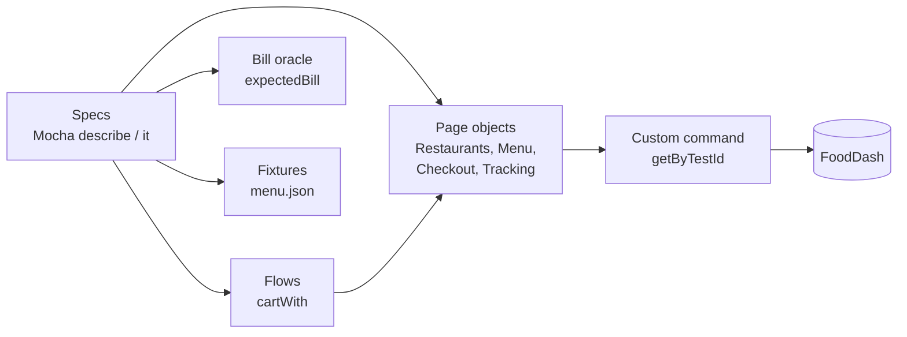

<div align="center">

# 🍕 Cypress + Mocha UI Framework

**End-to-end UI tests for FoodDash food delivery, from menu to delivered order**

   

[](https://github.com/skamirullah/practiceqa-cypress-mocha-ui/actions/workflows/ci.yml)  

[What it tests](#-what-it-tests) · [Quick start](#-quick-start) · [How it is built](#-how-it-is-built) · [Structure](#-project-structure) · [Reports](#-reports-and-debugging)

</div>

---

## 👋 Overview

A UI automation framework in Cypress. It orders food end to end, customises a pizza, applies coupons, checks every line of the bill and follows the order until it is delivered.

|  |  |
|---|---|
| **App under test** | [FoodDash](https://www.practiceqaautomation.com/apps/food), a food delivery app with restaurants, customisable items and live order tracking |
| **Kind of testing** | UI, end to end |
| **Tests** | 14 tests |
| **Runs in** | Electron, Chrome, Firefox or Edge |

### Highlights

- **Page objects without the ceremony.** Small classes with chainable actions.
- **A bill calculator as the oracle.** Expected totals come from the pricing rules, not typed-in numbers.
- **Waits for real events.** Order tracking is asserted by waiting for status text, never by sleeping.
- **Tags.** `@smoke` tests run alone with one command.

## 🎯 What it tests

| Area | What is checked |
|---|---|
| Finding a restaurant | List, cuisine filter, opening a menu |
| Ordering | Customised pizza with size and toppings, quantity stepper, cart count |
| Order tracking | Preparing → Out for delivery → Delivered |
| Bill | Delivery fee on small orders, free delivery above the threshold, 5% taxes |
| Coupons | Unknown code, below the minimum order, discount capped at its maximum |
| Checkout validation | Empty cart, missing address, phone and payment, cash-on-delivery limit |

## 🚀 Quick start

**You need:** Node.js 20+.

```bash
git clone https://github.com/skamirullah/practiceqa-cypress-mocha-ui.git
cd practiceqa-cypress-mocha-ui
npm install
```

| Command | What it does |
|---|---|
| `npm test` | Run every spec headlessly |
| `npm run test:smoke` | Run only tests tagged `@smoke` |
| `npm run test:chrome` | Run in Chrome |
| `npm run test:mobile` | Run at a phone-sized viewport |
| `npm run open` | Open the Cypress app to watch and debug |
| `npm run lint` | Check the code with ESLint |

## 🧱 How it is built



- **One locator strategy.** The app exposes `data-testid` on every control, wrapped in a single `cy.getByTestId` command.
- **Flows for setup.** `cartWith(restaurant, item, qty)` gets a test to checkout in one line, so the test shows only what it checks.
- **Oracle over constants.** `expectedBill()` applies the delivery, coupon and tax rules, so tests survive a menu price change.
- **Fixtures for data.** Restaurant and item ids live in `menu.json`.
- **Retries in CI only.** One retry in `cypress run`, none in `cypress open`, so flakiness is not hidden while developing.

## 📁 Project structure

```text
cypress
├── e2e/fooddash
│   ├── restaurants.cy.js           # finding a restaurant
│   ├── order.cy.js                 # ordering and tracking
│   ├── bill.cy.js                  # delivery fee, taxes, coupons
│   └── checkout.validation.cy.js   # form validation
├── support
│   ├── pages/                      # restaurantsPage, menuPage, checkoutPage, trackingPage
│   ├── flows.js                    # shortcuts that put the app in a known state
│   ├── commands.js                 # cy.getByTestId
│   └── e2e.js
├── utils/bill.js                   # test oracle for the bill
└── fixtures/menu.json
cypress.config.js
```

## ⚙️ Configuration

Settings live in `cypress.config.js`. Any of them can be overridden from the command line or with `CYPRESS_` environment variables.

| Setting | Default | What it does |
|---|---|---|
| `baseUrl` | the live site | Site to test. Override with `CYPRESS_BASE_URL`. |
| `viewportWidth` / `viewportHeight` | `1366` × `900` | Browser size. `npm run test:mobile` uses a phone size. |
| `retries.runMode` | `1` | Retries for a failed test in headless runs. |
| `grepTags` | none | Run only tests with a tag, for example `@smoke`. |

## 📊 Reports and debugging

- **Mochawesome**: `reports/index.html`, one self-contained file with charts.
- **Screenshots** of failures are embedded in the report.
- **`npm run open`** gives time-travel debugging in the Cypress app.

## 🔁 Continuous integration

[GitHub Actions](.github/workflows/ci.yml) lints and runs the specs on every push and pull request and uploads the HTML report.

## 🧪 About the app under test

FoodDash has restaurants by cuisine, items you can customise, a cart, coupons, tips, three ways to pay, and an order that moves through its stages on a timer.

[PracticeQAAutomation](https://www.practiceqaautomation.com) is a free practice site for QA engineers, with realistic apps to automate with Selenium, Playwright and Cypress. All data in these tests is fictional.

## 👤 Author

**Sk Amir Ullah** · Technical Lead, SDET and Test Automation

[Portfolio](https://skamirullah.com) · [LinkedIn](https://linkedin.com/in/skamirullah) · [GitHub](https://github.com/skamirullah) · [PracticeQAAutomation](https://www.practiceqaautomation.com)

## 📄 License

[MIT](LICENSE)
